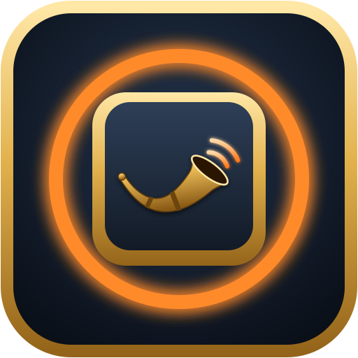

# Rallyhorn

World buff timer for **WoW Forever**. Rallyhorn tracks Rend, Onyxia and other
world buff drops for Horde and Alliance, warns you before they land, and
shares timers with your guild and group.

Rallyhorn only shows information. It never casts, targets, moves or clicks
anything for you.

## Download and install

**Easiest (Windows): the updater.** It installs Rallyhorn and keeps it up to
date, so you never copy folders by hand.

1. Open the [Releases page](https://github.com/Zudryx/Rallyhorn/releases) and
   download `RallyhornUpdater.zip` from the newest release.
2. Unzip it somewhere that isn't your AddOns folder (your Documents, for
   example) and double-click **Update Rallyhorn.bat**. It finds
   `World of Warcraft\_forever_\Interface\AddOns` (or asks you once), installs
   the newest version and shows what changed. If Windows warns about an
   unknown app, choose *More info* > *Run anyway*.
3. Run it again whenever you want to check for a new version. Your old copy
   is kept in a `backup` folder next to the updater, and your timers and
   settings are never touched.

**By hand.** Download `Rallyhorn-x.y.z.zip` from the newest release that isn't
marked *Pre-release*, unzip it and copy the `Rallyhorn` folder into
`World of Warcraft\_forever_\Interface\AddOns\`.

Then restart the game completely (a new addon isn't picked up by `/reload`)
and check that Rallyhorn is ticked in the **AddOns** list on the character
screen. Type `/rhorn` in game to show or hide the window.

**Test builds.** Releases marked *Pre-release* (named "test 1", "test 2" and
so on) are for trying changes early and can have bugs. **Update Rallyhorn
(testing).bat** installs them; **Update Rallyhorn.bat** takes you back to the
normal releases. Test builds are never sent to CurseForge.

## Full guide

Everything else is in [`Rallyhorn/README.md`](Rallyhorn/README.md), the same
guide that comes in the download: slash commands, how detection and sharing
work, capture mode, the in-game test checklist, known limits and the list of
changes.

## Found a problem?

Open an issue and include:

- what you saw and what you expected,
- the time it happened and where you were (city or zone),
- if you can, the capture log: turn on `/rhorn capture on`, wait for it to
  happen again, `/reload`, and copy the `capture` part of
  `WTF\Account\<your account>\SavedVariables\Rallyhorn.lua`. Remove other
  players' names before posting.

## License

Copyright (C) 2026 Zudryx. Rallyhorn is free software under the GNU General
Public License, version 3 or later (see [`LICENSE`](LICENSE)).

The Rallyhorn name and logo aren't covered by the GPL. Modified versions must
use a different name and logo (see [`NOTICE.md`](NOTICE.md)).

World of Warcraft and WoW Forever are trademarks of Blizzard Entertainment.
Rallyhorn is a fan-made addon, not affiliated with or endorsed by Blizzard.
